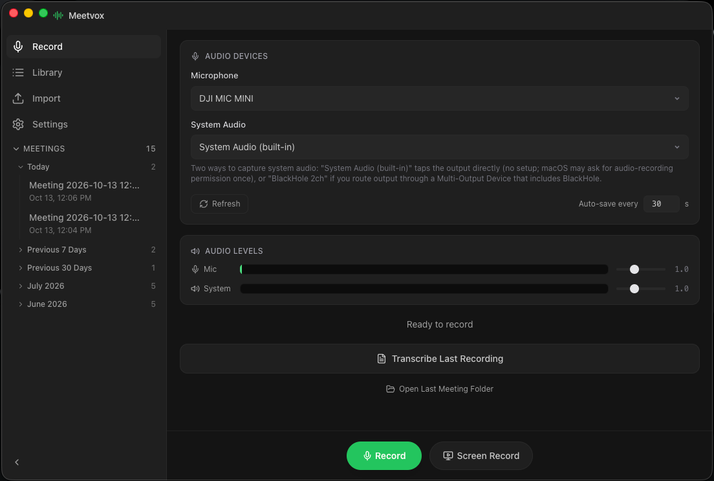

# Meetvox

Record a meeting and get a transcript that already knows who said what, without sending your audio anywhere.



Meetvox is a desktop app for macOS and Windows that records both sides of a conversation, your microphone and the audio coming out of your computer, then transcribes them on your own machine with a bundled build of [whisper.cpp](https://github.com/ggerganov/whisper.cpp). By default nothing is uploaded. There is no Python, and no cloud service in the recording or default transcription path.

The trick to the speaker labels is simple. Your mic is recorded on the left channel, the system output (everyone else on the call) on the right. Each channel is transcribed on its own, so the left side becomes **You** and the right side becomes **Other**. No diarization model, no guessing, just a clean split of two audio sources you already have.

## What it does

- Records your mic and the system audio as separate channels, so the transcript is speaker-attributed by construction.
- Transcribes locally with whisper.cpp by default. Your audio, transcripts, and notes stay on the machine.
- Lets you pick the local model: Large v3 Turbo (compressed) by default, up to full Large v3 for the most accuracy on a fast computer.
- Can transcribe with a whisper.cpp server on your network, OpenAI, or Groq instead, if you choose one in Settings → Transcription.
- Captures system audio on macOS through a Core Audio process tap, so there is no virtual audio driver to install. macOS asks for System Audio Recording permission once.
- Captures system audio on Windows through WASAPI loopback, or a virtual cable like VB-Cable for the most reliable path.
- Keeps a library of past meetings with an audio player that follows along with the transcript.
- Lets you take notes per meeting in a built-in editor.
- Imports an existing audio file and transcribes it.
- Generates an optional AI summary through your own Claude, Codex, or OpenAI account. This is off by default.
- Lives in the menu bar / tray so you can start and stop without hunting for the window.

## How recording works

Both platforms record 30-second stereo WAV chunks at 44.1 kHz: left channel is the mic, right channel is the system output. When you stop, each channel is split out, normalized, run through whisper.cpp, and merged back into a single timeline of `[time] Speaker: text` lines.

**macOS.** System audio is captured with a Core Audio process tap through a small Swift helper (`meetvox-syscap`) on macOS 14.4 and later. No BlackHole, no Multi-Output Device. The first recording triggers the System Audio Recording permission prompt; after you grant it, it is plug and play. On older macOS, route your output through a Multi-Output Device that includes a BlackHole virtual cable and select that as the system source instead.

**Windows.** System audio comes from a WASAPI render endpoint captured as a loopback input, or from a virtual cable. The virtual cable route (install [VB-Cable](https://vb-audio.com/Cable/), set it as the default output, pick `CABLE Output` as System Audio in the app) is the recommended path because it captures reliably on every build. See [resources/win-x64/README.md](resources/win-x64/README.md) for the details.

The microphone is captured with [naudiodon2](https://www.npmjs.com/package/naudiodon2) (PortAudio) on both platforms.

## Privacy

Everything is local by default. Recording, transcription, notes, and the meeting library all stay on disk.

Two features can use the network, and both stay off until you turn them on in Settings:

- A non-local transcription engine. A Whisper server, OpenAI, or Groq receives your audio. Settings says so under each engine.
- The AI summary. It is disabled until you enable a provider and add a credential, and the UI shows a note before you turn on anything that uses the network.

API keys are stored in the operating system's secure vault (`safeStorage`), used only in a request header, and never written to a log or a URL.

## Requirements

- Node.js 22.12 or later, to build from source (Electron 44's npm package needs it)
- macOS 13.3 or later, Apple silicon or Intel. macOS 14.4 or later for the no-driver capture path (earlier macOS falls back to a BlackHole virtual cable)
- Windows 10 or 11, x64. Nothing else to install: whisper.cpp and ffmpeg ship inside the app, and they need no Visual C++ runtime

The Whisper model is not bundled. The one you pick in Settings → Transcription downloads on the first transcription to `~/.meetvox/models/` on macOS or `%USERPROFILE%\.meetvox\models\` on Windows. The default, `ggml-large-v3-turbo-q5_0.bin`, is about 574 MB. An install that already has the old default (`ggml-large-v3-q5_0.bin`) keeps using it.

On Windows, whisper.cpp runs on the CPU only, so Turbo is the practical choice there.

## Run it (development)

### macOS

```bash
npm install
npm run rebuild        # rebuild naudiodon2 against Electron's ABI
npm run binaries:mac   # build whisper-cli, ffmpeg and meetvox-syscap into resources/mac-*/
npm run dev
```

`binaries:mac` needs the Xcode command line tools, `cmake`, and `git`.

### Windows

From the repo root in PowerShell:

```powershell
powershell -ExecutionPolicy Bypass -File .\setup-win.ps1 -BuildBinaries
npm run dev
```

The setup script installs dependencies, rebuilds the native audio addon for Electron, and builds `whisper-cli.exe` and `ffmpeg.exe` into `resources/win-x64/` through WSL. Drop `-BuildBinaries` to only check what is missing. Without WSL, run `npm run binaries:win` on a Mac or Linux machine (it uses Docker when mingw-w64 isn't installed) and copy `resources/win-x64/` over.

## Build a packaged app

The binaries Meetvox spawns, `whisper-cli` and `ffmpeg` (plus `meetvox-syscap` on macOS), are not committed. `npm run binaries:mac` and `npm run binaries:win` build them from pinned upstream sources; [resources/README.md](resources/README.md) has the details. The `dist` scripts stop with a list of missing files if any binary is absent.

```bash
npm run dist:mac      # DMG
npm run dist:win      # NSIS installer
```

The licenses for the bundled whisper.cpp and FFmpeg builds ship inside the app, in [resources/licenses/](resources/licenses/THIRD_PARTY_NOTICES.md).

## Other commands

```bash
npm test         # unit tests (audio encoding, transcript formatting, device logic, summaries)
npm run typecheck
```

## Output layout

A finished meeting is a self-contained folder under the app's user-data directory:

```
recordings/meeting_YYYYMMDD_HHMMSS/
├── chunk_001.wav     # stereo: L = mic, R = system, 44.1 kHz int16
├── transcript.txt    # [HH:MM:SS] Speaker:\n text
├── transcript.json   # [{ time, speaker, text }, ...]
└── summary.json      # only if you generated an AI summary
```

## Stack

| Concern | Choice |
|---|---|
| Shell | Electron (electron-vite) |
| UI | React + Tailwind CSS |
| Mic capture | naudiodon2 (PortAudio) |
| System audio (macOS) | Core Audio process tap via the `meetvox-syscap` Swift helper |
| System audio (Windows) | WASAPI loopback via naudiodon2 |
| Transcription | bundled whisper.cpp (`whisper-cli`), or a Whisper server, OpenAI, or Groq |
| Audio processing | bundled `ffmpeg` (LGPL build) |
| AI summaries (optional) | Claude Code CLI, Codex CLI, Claude API, or any OpenAI-compatible API |
| Packaging | electron-builder (DMG / NSIS) |

## Project status

The recording, transcription, library, notes, import, and summary features are built and covered by unit tests. The macOS capture path is the most exercised. The roughest edge is Windows system audio: `naudiodon2` does not expose PortAudio's loopback flag, so plain render-endpoint capture can come up silent on some machines, and the VB-Cable route is the dependable workaround. On-device validation of live dual capture, packaging, and code signing is still in progress.

## License

MIT. See [LICENSE](LICENSE).
